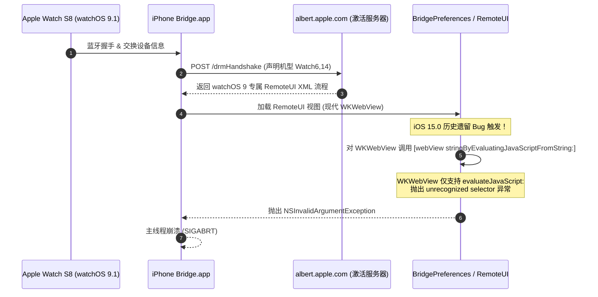

> **设备环境**：
> - **iPhone**：iPhone XS Max（A12，arm64e），系统 iOS 15.0（Build 19A346）
> - **环境状态**：TrollStore 纯巨魔环境（未激活越狱、无 ElleKit/Substrate 全局 Tweak 注入守护进程）
> - **Apple Watch**：Apple Watch Series 8（Watch6,14），系统 watchOS 9.1
> - **辅佐工具**：Legizmo Kincaid 4.2.3、Filza File Manager、TrollFools、Xcode 16.4 工具链

---

## 一、故障现象与排查背景

在通过 iOS 15.0 系统的官方 **Watch（Bridge）** 应用配对运行 **watchOS 9.1** 的 **Apple Watch Series 8** 时，配对流程在接近完成阶段（进入条款同意、诊断信息或手表设置渲染界面）**必定发生闪退**，导致配对中断并强制回滚（手表端退回欢迎星云表盘，手机端退出应用）。

此前设备已安装 Legizmo Kincaid 4.2.3（TrollStore 模式），但依然无法避免闪退。

---

## 二、诊断思考与排查过程

### 1. 建立非侵入式底层监控通道
为了捕获闪退瞬间的真实底层上下文，通过 USB 调试通道（`libimobiledevice`）对设备建立过滤日志监控：
- 使用 `idevicesyslog` 重点监听 `Bridge`、`nanoregistryd`、`pairedsyncd`、`BridgePreferences` 等进程；
- 避免全量日志导致磁盘瞬间爆满，精准收集配对通信与渲染事件。

### 2. 捕获崩溃现场日志（Crash Reports）
在复现闪退瞬间，成功抓取到两份核心崩溃转储（`.ips` 文件）：
- `Bridge-2026-10-24-074411.ips`
- `Bridge-2026-10-24-081733.ips`

两份崩溃报告的核心特征完全一致：
- **崩溃进程**：`com.apple.Bridge`
- **崩溃信号**：`EXC_CRASH (SIGABRT)`
- **崩溃线程**：主线程 `com.apple.main-thread`

调用栈关键截断点：
```text
CoreFoundation: +[NSException raise:format:]
libobjc.A.dylib: objc_exception_throw
CoreFoundation: ___forwarding___
UIKitCore: -[NSObject(NSKeyValueCoding) doesNotRecognizeSelector:]
BridgePreferences + 81468
Bridge + 167060
RemoteUI + 152100 -> RemoteUI + 264840
```

### 3. 抓取真正的“元凶”报错
结合毫秒级系统 syslog 交叉比对，在 `08:17:32.780` 抓取到了未捕获异常的明细原因：

```log
Oct 24 08:17:32.780618 Bridge(CoreFoundation): -[WKWebView stringByEvaluatingJavaScriptFromString:]: unrecognized selector sent to instance 0x10389aa00
Oct 24 08:17:32.781259 Bridge(CoreFoundation): *** Terminating app due to uncaught exception 'NSInvalidArgumentException', reason: '-[WKWebView stringByEvaluatingJavaScriptFromString:]: unrecognized selector sent to instance 0x10389aa00'
```

紧接着，守护进程 `nanoregistryd` 检测到配对应用退出，触发事务回滚并断开连接：
```log
Oct 24 08:17:32.937523 nanoregistryd: EPRoutingSlip: Rolling back saga entry
Oct 24 08:17:33.810888 nanoregistryd: Sent IDS request willUnpairRequest to Watch
```

---

## 三、根本原因深度剖析



1. **苹果官方代码的历史遗留 API 错配 Bug**：
   - 在 iOS 15 中，苹果将系统内的很多网页渲染框架（如 `RemoteUI.framework`）全面重构并升级为基于现代 WebKit 的 **`WKWebView`**。
   - 但是在 **iOS 15.0 最初发布版本**中，负责手表配对配置与外观展示的私有框架 **`BridgePreferences.framework`** 内部，仍然残留了早期基于 `UIWebView` 的老旧调用代码。
   - 在页面初始化与脚本注入时，代码直接向 webview 发送了 `stringByEvaluatingJavaScriptFromString:` 这一历史同步方法。
2. **为什么配对 Series 8 必现？**
   - 苹果激活服务器（`albert.apple.com`）下发给 watchOS 9 / Series 8 的 XML 描述文件中包含新版条款、诊断与新功能提示页面，这些页面必然会触发 `BridgePreferences` 注册的脚本回调。
   - `WKWebView` 根本不存在此方法，Objective-C 消息转发失败，引发 `NSInvalidArgumentException`，导致主进程直接 `abort()` 闪退。
3. **为什么 Legizmo Kincaid 4.2.3 未能拦截？**
   - Legizmo 4.2.3 是较早期版本，且当前手机处于**纯 TrollStore 环境**（无越狱基板/ElleKit 全局 hook）。
   - Legizmo 的 Native 模式在纯 TrollStore 下缺乏对 Bridge 进程执行动态 Category 注入的能力，导致系统层面的调用直接穿透到了原生的 `WKWebView` 上。

---

## 四、技术修复方案实施

因为崩溃的本质是 **`WKWebView` 缺少了 `stringByEvaluatingJavaScriptFromString:` 分发方法**，最优雅、最底层的修复思路不是重新打包整个庞大的系统固件，而是：
> **通过 Runtime 动态为 `WKWebView` 补充一个 Category 分类方法，当被调用时自动转为异步的 `evaluateJavaScript:` 执行，并安全返回，消除崩溃。**

### 0. 补丁附件直接下载
如果你遇到相同问题，可直接下载已完成交叉编译并 Ad-Hoc 签名的双架构动态库：

- 📥 **直链下载**：[BridgeFix.dylib](/downloads/BridgeFix.dylib)
- 🔗 **GitHub 镜像源**：[BridgeFix.dylib (GitHub raw)](https://github.com/hfly2019/hfly2019.github.io/raw/main/downloads/BridgeFix.dylib)
- 🛡️ **SHA-256 校验和**：
- ⚙️ **适用架构**： +  双架构通用动态库

---

### 1. 编写补丁源码 (`BridgeFix.m`)

```objc
#import <Foundation/Foundation.h>
#import <WebKit/WebKit.h>
#import <objc/runtime.h>

@interface WKWebView (BridgeFix)
- (NSString *)stringByEvaluatingJavaScriptFromString:(NSString *)script;
@end

@implementation WKWebView (BridgeFix)

- (NSString *)stringByEvaluatingJavaScriptFromString:(NSString *)script {
    NSLog(@"[BridgeFix] 成功拦截 -[WKWebView stringByEvaluatingJavaScriptFromString:]: %@", script);
    if (!script || [script length] == 0) {
        return @"";
    }
    
    // 安全分发至现代的 WebKit evaluateJavaScript 接口
    if ([NSThread isMainThread]) {
        [self evaluateJavaScript:script completionHandler:^(id result, NSError *error) {
            if (error) {
                NSLog(@"[BridgeFix] evaluateJavaScript 执行警告: %@", error);
            }
        }];
    } else {
        dispatch_async(dispatch_get_main_queue(), ^{
            [self evaluateJavaScript:script completionHandler:nil];
        });
    }
    
    // 返回空字符串满足同步返回要求，彻底消除 unrecognized selector 异常
    return @"";
}

@end

__attribute__((constructor))
static void BridgeFixInit(void) {
    NSLog(@"[BridgeFix] 补丁已成功加载进进程: %d", getpid());
}
```

### 2. 原生交叉编译与签名

针对 iPhone XS Max（A12 仿生芯片，arm64e 架构），使用 macOS Xcode 命令行工具链编译并 ad-hoc 签名双架构动态库：

```bash
xcrun --sdk iphoneos clang -arch arm64 -arch arm64e -shared \
  -framework Foundation -framework WebKit \
  -isysroot $(xcrun --sdk iphoneos --show-sdk-path) \
  -miphoneos-version-min=15.0 \
  -install_name @executable_path/BridgeFix.dylib \
  -o BridgeFix.dylib BridgeFix.m

codesign -s - --force BridgeFix.dylib
```

### 3. 部署与极简注入（结合 TrollFools）

传统修补需要砸壳、重打包整个 `Bridge.app`，但由于苹果自带的 **Watch（Bridge）** 属于标准的可移除系统应用（Removable System App），且处于 TrollStore 环境下，可使用社区主流的原地注入工具 **TrollFools**：

1. **传输补丁**：通过局域网传输将编译好的 `BridgeFix.dylib` 导入手机，并保存至“文件”App（或“我的 iPhone”）。
2. **原地注入**：
   - 打开 **TrollFools**。
   - 在应用列表中选中系统内置的 **Watch（手表）**。
   - 点击右上角 **`+`** 号，选择刚才的 `BridgeFix.dylib`。
   - TrollFools 自动完成 Mach-O `LC_LOAD_DYLIB` 写入、沙盒路径重定位与权限修补。
3. **验证结果**：
   - 彻底关闭 Watch App 后重新打开，重新执行与 Apple Watch Series 8 (watchOS 9.1) 的配对流程。
   - 原先在 RemoteUI 页面处的闪退彻底消失，成功进入配对设置并配对完成！

---

## 五、经验总结与分享价值

1. **善用底层 Crash 证据**：
   遇到越狱/TrollStore 下系统级组件的反复闪退，优先分析 `.ips` 崩溃日志中的 `unrecognized selector` 或异常信息，避免在无意义的重复重置或抹掉设备中耗费时间。
2. **认知 iOS 15 系统 App 存储形态**：
   iOS 自带的可卸载应用（如 Watch、计算器、备忘录等）实际存放在 `/private/var/containers/Bundle/Application/` 下，本质与第三方 App 一样支持原地动态库注入。
3. **针对性 Hook / Category 修复优于全局替换**：
   仅需十几行代码为 `WKWebView` 补充一个缺失方法，即可跨越跨版本系统兼容性的深水坑，比降级或硬改整个系统 Framework 更轻量、安全、可逆。